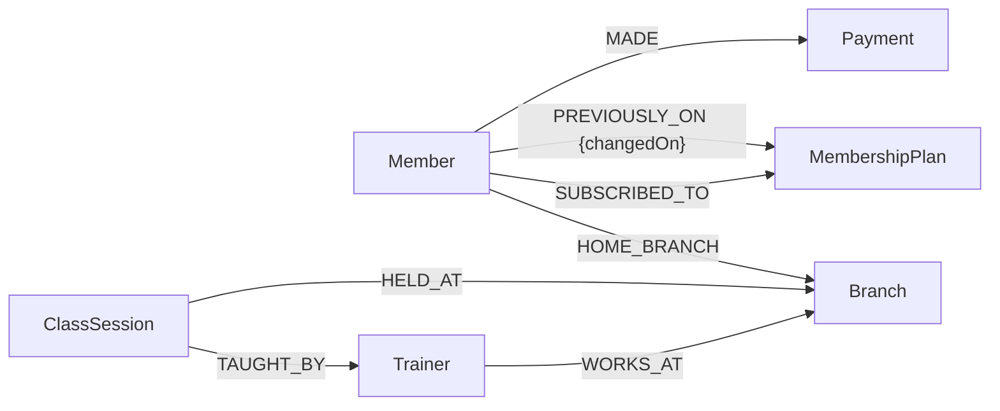

# Graph model and relational comparison

Six business labels, seven relationship types. AppUser is authentication-only and is excluded from graph queries. Its optional memberId/trainerId properties link login accounts to business records.

## MySQL-to-Neo4j mapping

| MySQL feature | Neo4j equivalent |
| --- | --- |
| Six tables | Six business node labels |
| Foreign keys | Directed typed relationships |
| plan_change_log | PREVIOUSLY_ON relationship with changedOn date |
| ID and unique name constraints | Community-compatible uniqueness constraints |
| CHECK phone, fee, amount | Zod validation inside API transaction workflows |
| v_member_details | memberDetails named read query |
| v_branch_revenue | branchReport named read query |
| v_class_timetable | timetable named read query |
| get_total_paid | sum of MADE payment amounts |
| get_branch_member_count | Branch aggregation |
| get_member_balance | max(current plan fee minus lifetime payments, zero) |
| register_member procedure | Managed member/edges/first-payment write transaction |
| make_payment procedure | Managed member existence check and payment creation |
| change_plan procedure | Locked update with PREVIOUSLY_ON history |
| branch_report cursor | Single aggregation query |
| trainer_schedule cursor | Optional class match, including empty trainers |
| pending_dues cursor | Aggregate then filter positive balances |
| Payment trigger | Positive integer validation |
| Plan history trigger | History creation in the same transaction |
| Member deletion trigger | Lock, inspect payment edges, refuse deletion |
| START TRANSACTION / ROLLBACK | executeWrite callback commit/throw rollback |
| SAVEPOINT | Whole-transaction rollback demo; savepoints are not emulated |

Only Cypher is executed. MySQL names above are explanatory mappings.

## Balanced comparison

MySQL handles fixed records, tabular reporting and declarative constraints naturally. SQL joins and aggregation work well for this application. Neo4j makes relationships explicit and directly traversable, particularly member-to-branch-to-trainer-to-class paths and the interactive graph explorer.

No benchmark establishes that Neo4j is faster or more scalable here. Community Edition lacks direct equivalents for some CHECK constraints and triggers; these rules live in the API and managed transactions. Direct database writers can bypass those rules. This is an integrity trade-off, not an unconditional improvement over MySQL.
